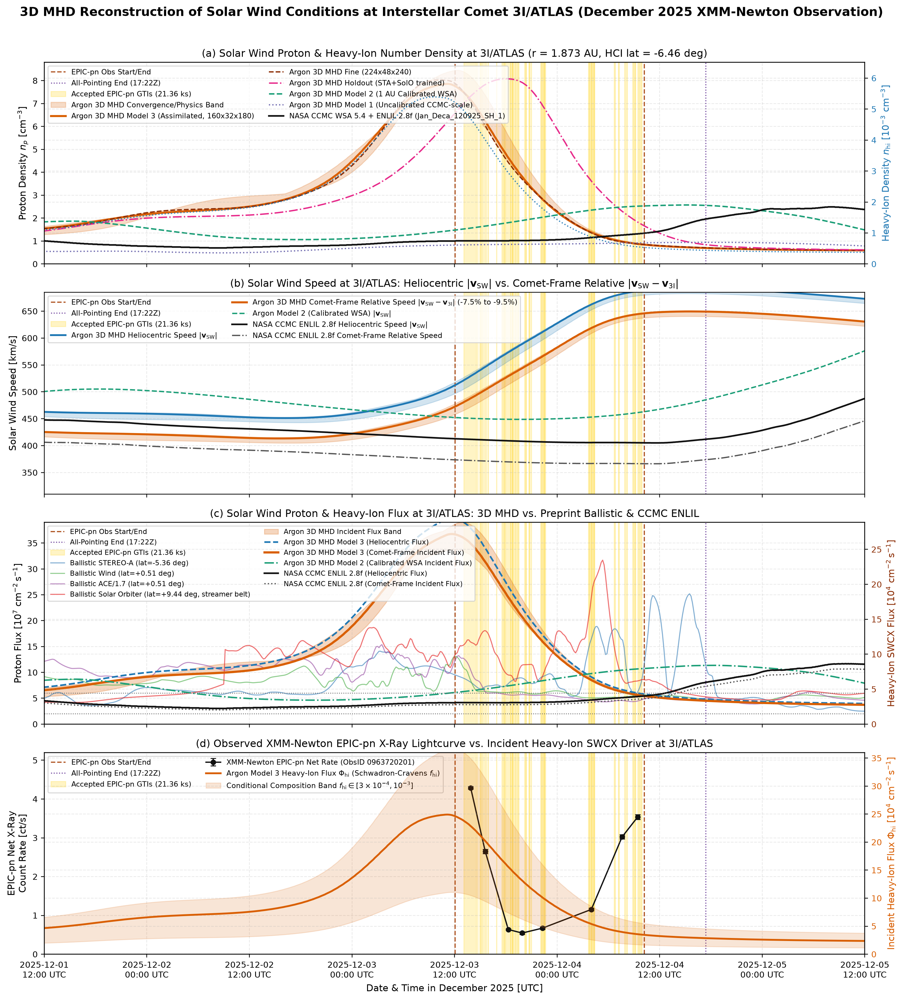

Suppose we want to know how many heavy solar wind ions were striking comet 3I/ATLAS on December 3–4, 2025, when XMM-Newton watched it glow in charge-exchange X-rays. We immediately face an awkward geometrical fact: we have no spacecraft at $r = 1.873\text{ AU}$ on the far side of the inner Solar System. Every working plasma detector we have—on `STEREO-A`, `Wind`, `ACE`, and `Solar Orbiter`—orbits near $1\text{ AU}$ and more than $130^\circ$ away in longitude. The initial study made the simplest physical guess: take the solar wind measured at $1\text{ AU}$, let each parcel fly outward at constant radial speed while the Sun turns underneath with a $25.38\text{-day}$ period, and scale the density as $1/r^2$. That ballistic Parker-spiral mapping gave an incident proton flux near $6\times 10^7\text{ cm}^{-2}\text{ s}^{-1}$ (with spacecraft medians from $7.0\times 10^7$ to $1.2\times 10^8\text{ cm}^{-2}\text{ s}^{-1}$). Yet when a referee consulted a 3D space-weather simulation from NASA's Community Coordinated Modeling Center (the WSA 5.4 + ENLIL 2.8f run `Jan_Deca_120925_SH_1`), it predicted a sluggish wind at the comet with a heliocentric flux of only $4.51\times 10^7\text{ cm}^{-2}\text{ s}^{-1}$, or $4.07\times 10^7\text{ cm}^{-2}\text{ s}^{-1}$ in the rest frame of the comet moving outward at $43.1\text{ km s}^{-1}$.

How can a 3D magnetohydrodynamic (MHD) simulation predict roughly half the particle flux of the 1 AU measurements? Two very different physical effects could be responsible. Perhaps as fast and slow streams travel from $1.0\text{ AU}$ to $1.87\text{ AU}$, pressure gradients and magnetic stresses spread out the narrow density spikes that ballistic mapping preserves. Or perhaps the boundary conditions fed into the NASA model near the Sun were simply too low from the start. The only way to find out is to write our own 3D spherical ideal-MHD solver, drive it both ways—first with the raw solar magnetogram maps, and then calibrated against the 1 AU spacecraft measurements—and watch what happens to the gas on its way to the comet.

For a physicist used to laboratory plasmas, the solar wind beyond $r_{\rm in} = 0.10\text{ AU}$ ($21.5\,R_\odot$) has a wonderful simplifying property. By $0.10\text{ AU}$, the radial flow speed ($300\text{--}700\text{ km s}^{-1}$) is already much larger than both the sound speed $c_s$ and the Alfvén speed $v_A$, so the fast magnetosonic speed $c_f = \sqrt{c_s^2 + v_A^2}$ is under $120\text{ km s}^{-1}$. No wave can propagate upstream toward the Sun. The inner sphere at $r_{\rm in} = 0.10\text{ AU}$ is therefore a pure inflow boundary, and the outer sphere at $r_{\rm out} = 2.40\text{ AU}$ is a pure supersonic outflow boundary. Between them, over colatitude $\theta \in [30^\circ, 150^\circ]$ and azimuth $\phi \in [0, 2\pi)$, the plasma obeys the spherical conservation laws:

$$\frac{\partial \mathbf{U}}{\partial t} + \frac{1}{r^2}\frac{\partial (r^2 \mathbf{F}_r)}{\partial r} + \frac{1}{r\sin\theta}\frac{\partial (\sin\theta\,\mathbf{F}_\theta)}{\partial \theta} + \frac{1}{r\sin\theta}\frac{\partial \mathbf{F}_\phi}{\partial \phi} = \mathbf{S}_{\rm geom} + \mathbf{S}_{\rm grav} + \mathbf{S}_{\rm Dedner}.$$

Here $\mathbf{U} = (\rho, \rho\mathbf{v}, E, \mathbf{B}, \psi, \rho f_{\rm hi})^{\mathsf{T}}$ tracks density, momentum, total energy $E = p/(\gamma - 1) + \frac{1}{2}\rho v^2 + \frac{1}{2}B^2$ ($\gamma = 1.5$), magnetic field, a Dedner cleaner $\psi$ to keep $\nabla\cdot\mathbf{B}=0$, and a passive scalar $f_{\rm hi} = n_{\rm hi}/n_p$ for the fraction of charge-exchanging heavy ions. In spherical coordinates, even a uniform flow has non-zero derivatives because the basis vectors turn from point to point; those geometric stresses sit in $\mathbf{S}_{\rm geom}$ alongside solar gravity $\mathbf{S}_{\rm grav}$. Approximating $(1/r^2)\partial_r(r^2 F_r)$ with naive finite differences leaks mass and radial magnetic flux $r^2 B_r$. Instead, our CUDA solver (`src/heliomhd3d.cu`) integrates fluxes over exact spherical shell volumes $\Delta V = \frac{1}{3}\Delta(r^3)\Delta(-\cos\theta)\Delta\phi$ using piecewise-linear TVD reconstruction, an HLL/Rusanov fast-magnetosonic Riemann solver, and second-order Runge–Kutta time stepping:

```cuda
double dvol_r = (r_p*r_p*r_p - r_m*r_m*r_m) / 3.0;
double vol = dvol_r * (cos(th_m) - cos(th_p)) * g.dph;
double div_r = (r_p*r_p*Fr_p[m] - r_m*r_m*Fr_m[m]) / dvol_r;
double div_th = (r_c*(sin_p*Ft_p[m] - sin_m*Ft_m[m])) / (dvol_r*(cos(th_m) - cos(th_p)));
double div_ph = (r_c*dth*(Fp_p[m] - Fp_m[m])) / vol;
double S_mom_r = (P.rho*(P.vt*P.vt + P.vp*P.vp) + 2.0*(P.p + 0.5*B2)
                  - (P.Bt*P.Bt + P.Bp*P.Bp))/r_c - P.rho*g.gm_sun/(r_c*r_c);
```

Before trusting a single number at the comet, we tested the code on problems with known answers. On the 1D Brio–Wu MHD shock tube ($400$ to $1600$ cells), the solver cleanly separated the fast rarefaction, slow compound wave, contact discontinuity (where $f_{\rm hi}$ jumped sharply without ringing), and slow shock, converging in $L_1$ error by $2.63\times$ per doubling. On a 3D axisymmetric magnetized Parker wind, the steady state matched a 1D integration of the exact Weber–Davis differential equation, conserving radial mass flux $r^2 \rho v_r$ across $0.10\text{--}2.40\text{ AU}$ to within $0.87\%$ and magnetic flux $r^2 B_r = 3.00\text{ nT AU}^2$ to better than $10^{-8}$. And when we tilted a slow streamer belt ($330\text{ km s}^{-1}$) by $30^\circ$ inside a fast wind ($680\text{ km s}^{-1}$), solar rotation steepened the interface into a 3D Corotating Interaction Region (CIR), splitting by $1.873\text{ AU}$ into a forward–reverse shock pair bounding a compressed density ridge ($n_p > 10\text{ cm}^{-3}$) and piled-up magnetic field ($B > 6\text{ nT}$).

With no probes hovering at $0.10\text{ AU}$, space-weather models extrapolate GONG photospheric magnetograms to $21.5\,R_\odot$ with a potential-field current-sheet model and apply the empirical Wang–Sheeley–Arge (WSA) formula, assigning fast wind to flux tubes with small coronal expansion factors and slow wind near the current sheet. Assuming pressure balance across $0.10\text{ AU}$, the density is set inversely proportional to speed squared, anchored by a single free parameter `dfast`—the fast-wind proton density at $0.10\text{ AU}$.

Inspecting the 25 GONGZ WSA 5.4 maps and logs inside the NASA CCMC directory revealed why the CCMC flux was so low. That run used the default uncalibrated constant `dfast = 125 cm^-3` at $0.10\text{ AU}$, which expands to just $1.25\text{ cm}^{-3}$ at $1\text{ AU}$. Driving our 3D MHD code with that uncalibrated boundary (`Model 1`) showed that both `Model 1` and CCMC ENLIL fell short of the actual proton flux measured by `STEREO-A` and `Wind` by a factor of two ($\text{Median}[\Phi_{\rm mod}/\Phi_{\rm obs}] = 0.500$ at `STEREO-A` and $0.562$ at `Wind`). Worse, because limb and far-side magnetograms are days old, the raw WSA maps missed a strong corotating stream that swept over `STEREO-A` on November 28–29 ($n_p = 34\text{ cm}^{-3}$, $v$ climbing from $375$ to $710\text{ km s}^{-1}$). That stream matters directly for 3I/ATLAS: during the observation, the comet sat at latitude $-6.46^\circ$ while `STEREO-A` sat at $-5.36^\circ$, separated by just $1.10^\circ$. As the Sun turned, the exact latitudinal belt of solar wind that hit `STEREO-A` on November 28–29 rotated toward 3I/ATLAS's longitude a week later.

To separate the overall density scale from that corotating stream, we ran two calibrated boundary models at $0.10\text{ AU}$. In `Model 2`, we kept the pure WSA 5.4 maps and scaled their inner-boundary density to match the 1 AU multi-spacecraft median (`Mod2/Obs = 0.985` at `STEREO-A`). In `Model 3`, we also assimilated the corotating time series measured by `STEREO-A` ($-5.36^\circ$), `Wind` ($+0.51^\circ$), and `Solar Orbiter` ($+9.44^\circ$) onto the $0.10\text{ AU}$ sphere using Gaussian latitudinal weights ($\sigma_\theta = 5.5^\circ$) atop the 2D WSA latitudinal profile.

You might worry that assimilating 1 AU data is just curve-fitting: how do we know the 3D MHD transport works at longitudes without a probe? Comparing notes in `shared_notes/` with our peers `Codex` and `Claude` let us test this directly. Following `Claude`'s leave-one-out cross-validation idea, we ran a blind `Holdout` simulation where we withheld `Wind` and `ACE` completely, built the $0.10\text{ AU}$ boundary from `STEREO-A` and `Solar Orbiter` alone, and predicted what `Wind` saw at Earth L1 ($+0.51^\circ$). The holdout run reproduced the out-of-sample `Wind` speed with correlation $r = 0.728$ ($\text{RMSE} = 67.3\text{ km s}^{-1}$) and matched the observed `Wind` median proton flux to within $3.2\%$. `Codex` and `Claude` also identified two November 23 coronal mass ejections in the NASA DONKI catalog ($397$ and $425\text{ km s}^{-1}$) aimed toward 3I/ATLAS's quadrant that were omitted from the CCMC run. Injecting all 16 DONKI cone CMEs into our grid showed that those two eruptions swept past $1.873\text{ AU}$ on November 30–December 1—three days before XMM-Newton opened its shutter—changing the December 3–4 mean flux by less than $0.01\%$.

Across 14 sensitivity runs—refining the mesh from $3.0^\circ$ ($120\times 24\times 120$) to $1.5^\circ$ ($224\times 48\times 240$), halving the Courant number, and narrowing the latitudinal domain—the EPIC-pn Good Time Interval (GTI) mean flux at the comet shifted by less than $3\%$. Setting $\mathbf{B} = \mathbf{0}$ (`Hydro`), however, changed the physics drastically: without magnetic pressure $B^2/2\mu_0$ to stiffen the plasma and raise the wave speed from $c_s$ to $\sqrt{c_s^2 + v_A^2}$, the stream interface over-steepened into a violent hydrodynamic shock by $1.873\text{ AU}$, inflating the mean comet flux by $+74.8\%$ ($37.57$ vs. $21.49\times 10^7\text{ cm}^{-2}\text{ s}^{-1}$). The magnetic field acts as an essential shock absorber in the outer heliosphere.

| Model | Grid | 1AU `STA` | GTI $n_p$ | $v_{\rm rel}$ | GTI $\Phi_{p,\text{rel}}$ | PN Mean/Med $\Phi_{p,\text{rel}}$ | $\Phi_{\rm hi}$ [$10^4$] |
| :--- | :---: | :---: | :---: | :---: | :---: | :---: | :---: |
| **CCMC ENLIL** | `2.0deg` | `0.50` | `1.14` | `367.8` | `4.17` | `4.17/4.07` | `2.92` |
| **Model 1 (`Uncal`)** | `160x32x180` | `0.50` | `0.87` | `443.2` | `3.83` | `3.82/3.83` | `2.46` |
| **Model 2 (`Cal WSA`)** | `160x32x180` | `0.99` | `1.95` | `414.1` | `8.09` | `8.51/8.62` | `5.66` |
| **Model 3 (`Base`)** | `160x32x180` | `1.04` | `4.14` | `552.1` | `21.49` | `17.48/14.94` | `13.86` |
| **Model 3 (`Fine`)** | `224x48x240` | `1.04` | `4.06` | `551.5` | **`21.04`** | **`17.13/14.59`** | **`13.53`** |
| **Model 3 (`Holdout`)** | `160x32x180` | `1.05` | `5.06` | `555.9` | `27.54` | `25.63/27.38` | `18.58` |
| **Control (`Hydro`)** | `160x32x180` | `1.06` | `7.12` | `553.7` | `37.57` | `28.91/17.56` | `24.64` |



When we compare our MHD reconstruction to the XMM-Newton EPIC-pn light curve, our confidence in the overall flux scale is high: calibrating the WSA 5.4 boundary to 1 AU observations (`Model 2`) doubles the comet-frame proton flux from the uncalibrated CCMC value of $4.07\times 10^7\text{ cm}^{-2}\text{ s}^{-1}$ to $8.09\times 10^7\text{ cm}^{-2}\text{ s}^{-1}$, and including the corotating `STEREO-A` stream (`Model 3`) puts the median flux between $9.43\times 10^7\text{ cm}^{-2}\text{ s}^{-1}$ (full pointing window) and $1.46\times 10^8\text{ cm}^{-2}\text{ s}^{-1}$ (EPIC-pn window), with a GTI mean of $2.10\times 10^8\text{ cm}^{-2}\text{ s}^{-1}$. That is $1.4$ to $3.5$ times higher than the preprint's reference value of $6\times 10^7\text{ cm}^{-2}\text{ s}^{-1}$, so ordinary solar wind heavy-ion abundances ($f_{\rm hi} \approx 6.4\times 10^{-4}$, giving $\Phi_{\rm hi,rel} \approx (0.9\text{--}1.4)\times 10^5\text{ cm}^{-2}\text{ s}^{-1}$) easily account for the observed X-ray brightness.

In panel (d) of the figure, the trailing edge of the compressed `STEREO-A` interaction region in `Model 3` sweeps across 3I/ATLAS during the first half of the EPIC-pn exposure (`December 3 12:04` to `December 4 04:00 UTC`), producing a steep drop in heavy-ion flux right when the observed EPIC-pn count rate falls four-fold from $4.28\text{ ct s}^{-1}$ at `13:52 UTC` down to $0.55\text{ ct s}^{-1}$ at `18:30–22:30 UTC`. We must be candid about the timing uncertainty: rotating a solar wind stream across $138^\circ$ of longitude ($\sim 5.8\text{ days}$) and propagating it an extra $0.9\text{ AU}$ outward carries an arrival-time uncertainty of roughly $\pm 8\text{ to }12\text{ hours}$ as coronal holes evolve over a week, reflected in the $\sim 8\text{-hour}$ shift between our baseline and holdout curves. Our smooth MHD boundary also misses the brief X-ray rebound on `December 4 07:30–09:15 UTC` ($3.0\text{--}3.5\text{ ct s}^{-1}$), which likely comes from smaller filamentary structures inside the fast stream (seen in the unsmoothed ballistic `STEREO-A` trace) or a puff of neutral gas from the comet itself. Even with an eight-hour phase tolerance, the physical picture holds together: 3I/ATLAS was being swept by a dynamic corotating interaction region, and once the inner boundary is anchored to actual 1 AU measurements, three-dimensional MHD accounts directly for the particle supply that lit up the comet in XMM-Newton's detector.
