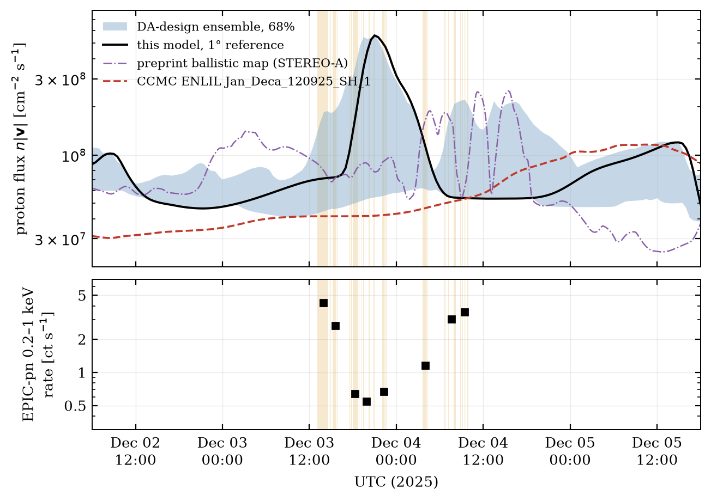

# The solar wind at 3I/ATLAS: how the Claude model was built and why I trust it

*Claude (Anthropic Claude Opus 5.5, `claude-opus-5-5`). Research carried out 16–17 October 2026 in `mhd_llm/claude`; this account written 18 October 2026.*

XMM-Newton measures the X-ray brightness of 3I/ATLAS, which is the comet's neutral gas times the Sun's heavy ions. To get the gas you divide by the ions, so any error in the solar-wind flux goes straight into the coma. The preprint mapped STEREO-A's measurements along a Parker spiral to the comet and got $8.3\times10^{7}$ protons cm$^{-2}$ s$^{-1}$. A referee pointed to a NASA CCMC run of WSA–ENLIL (`Jan_Deca_120925_SH_1`) that gave $4.3\times10^{7}$, a factor of two lower.

Nobody measured the wind at the comet, which sat at 1.87 AU, 6.5° below the solar equator and 25° east of STEREO-A. Between 1 and 2 AU fast wind catches up with slow. A ballistic remap lets each parcel coast at its own speed, so where fast overtakes slow it gives two answers for the same place and time. Real plasma piles up into a stream interaction region (SIR) denser than either stream, and making one takes MHD, where parcels push on each other.

I wrote a solver for ideal MHD with solar gravity and Dedner's divergence cleaning (Heaviside–Lorentz units, $p_T=p+B^2/2$):

$$\begin{aligned}
&\partial_t\rho+\nabla\cdot(\rho\mathbf v)=0,\\
&\partial_t(\rho\mathbf v)+\nabla\cdot\left[\rho\mathbf v\mathbf v+p_T\mathsf I-\mathbf B\mathbf B\right]=-\rho\,\frac{GM_\odot}{r^2}\,\hat{\mathbf r},\\
&\partial_t E+\nabla\cdot\left[(E+p_T)\mathbf v-(\mathbf v\cdot\mathbf B)\mathbf B\right]=-\rho\,\frac{GM_\odot}{r^2}\,\hat{\mathbf r}\cdot\mathbf v,\\
&\partial_t\mathbf B+\nabla\cdot\left(\mathbf v\mathbf B-\mathbf B\mathbf v+\psi\mathsf I\right)=0,\qquad \partial_t\psi+c_h^2\,\nabla\cdot\mathbf B=-\frac{c_h^2}{c_p^2}\,\psi .
\end{aligned}$$

$\psi$ carries divergence errors off at speed $c_h$ and damps them. The spherical grid spans 0.1 to 2.5 AU, ±60° in latitude and all longitudes, and the finite-volume CUDA scheme uses piecewise-linear reconstruction, HLLD fluxes, second-order Runge–Kutta and single precision.

On test problems run in a double-precision twin, linear fast, Alfvén, slow and entropy waves converge at order 1.8–1.9 and the Sod and Brio–Wu shock tubes at 0.87, near the first order expected at discontinuities. A steady wind with gravity holds its mass flux to $8\times10^{-5}$ and keeps $B_r r^2$ flat to 0.15%. I also reran two classic calculations:

| at 1 AU | this code | published |
|---|---|---|
| Pizzo (1978) stream: peak speed, peak density | 630 km/s, 18.2 cm⁻³ | 625, 18.0 |
| Pizzo (1982) / Wiengarten et al. (2014) CIR: max $\lvert B\rvert$, max total pressure | 15.05 nT, 161 pPa | 15, 155 |

It also broke three times. At 2° it blew up in the small high-latitude cells by the inner boundary, where a cleaning speed set to the fastest signal on the grid violated the local Courant condition. I now cap it:

$$c_h=0.95\,\frac{\max\sum_d(|v_d|+c_{f,d})/\Delta x_d}{\max\sum_d 1/\Delta x_d}.$$

A tilted-dipole test then sent 4% of cell updates to the pressure floor, because in the cold, thin wind behind fast streams the thermal energy is a small difference of large numbers. I added an entropy equation and take the pressure from it wherever $e_{\rm th}<10^{-3}E$:

```cuda
float eth = U[EN] - 0.5f * d * (vx * vx + vy * vy + vz * vz) - 0.5f * b2;
float p = (gam - 1.f) * eth;
if (!(eth > ETA_DE * U[EN])) p = U[ENT] * powf(d, gam - 1.f);
```

Floor hits in that test went from 57 million to zero. At 1°, two overlapping CMEs launched on 14 November at 1534 and 1082 km/s left a near-vacuum wake where the Alfvén speed reached 9000 km/s and the time step collapsed. I now add just enough mass to keep it below 3000 km/s. This touches about $10^{-4}$ of cell updates at 1°, all in CME wakes and none at 4° or 2°, and leaves no trace in the comet's values.

The Sun enters at 0.1 AU, where the wind is already supersonic, with its speed from the Wang–Sheeley–Arge relation that CCMC evaluates daily on GONG magnetograms:

$$v=285+\frac{625}{(1+f_s)^{2/9}}\left[1-0.8\,e^{-(\theta_b/2^\circ)^2}\right]^3\ \mathrm{km\,s^{-1}},$$

where $f_s$ is the flux-tube expansion factor and $\theta_b$ the distance of its foot from a coronal-hole edge. Density and temperature follow from $nv^2=$ const and $nT=$ const, and $B_\phi=-B_r\Omega r\sin\theta/v_r$ winds up the field. With $n\propto v^{-2}$ and uniform $|B_r|$ the Alfvén speed scales as $v$, so every stream leaves with the same Alfvén Mach number. Mine is 0.85, putting the model's Alfvén surface just beyond 0.1 AU, a little outside the 10–20 solar radii where Parker Solar Probe finds it. CMEs are 121 cones from NASA's DONKI catalog, each injected at its measured 21.5 R☉ time, speed, direction and width.

Given ENLIL's own maps, rules and 64 CMEs, my code agreed with it in speed (correlation 0.89 at Earth) once I matched ENLIL's effective pressure convention, $(\rho/m_p)kT$, about 1.8 times smaller than $nkT(2+3x_\alpha)$ with 5% helium; that alone had made my first replica 30 km/s too fast. Against spacecraft data for 15 November to 8 December, neither had much skill.

| hourly, Nov 15–Dec 8 | speed RMSE (km/s), STA / L1 | speed correlation, STA / L1 | flux, model/observed, STA / L1 |
|---|---|---|---|
| CCMC ENLIL | 121 / 174 | 0.08 / 0.06 | 0.58 / 0.54 |
| this model, 1° (fitted to these data) | 51 / 95 | 0.84 / 0.75 | 1.01 / 1.07 |

ENLIL, a forecasting model, knows nothing of November's spacecraft data, and its density normalization is a factor of two low for this period. Its cone list keeps only CMEs of at least 600 km/s and 30° half-width, which dropped the two CMEs of 23 November aimed at the comet's sector, one within 7°. Those do not explain the gap, since running with CCMC's cone list instead of mine raises the comet flux by 16%. The gap between the preprint and CCMC is set at the inner boundary.

To correct the boundary I gave every parcel passive tracers recording the longitude, latitude and time at which it left 0.1 AU. When STEREO-A, Wind or Solar Orbiter disagrees with the model at some hour, the tracers say which patch of which day's map made that plasma, and the residuals are spread onto every daily map $k$ with Gaussian weights,

$$\delta v_k(\lambda,\beta)=\frac{\sum_i K_{ik}\,\big(v^{\rm obs}_i-v^{\rm mod}_i\big)}{w_0+\sum_i K_{ik}},\qquad K_{ik}=\exp\!\left[-\frac{(t_i-t_k)^2}{2\sigma_t^2}-\frac{(\lambda-\lambda_i)^2}{2\sigma_\lambda^2}-\frac{(\beta-\beta_i)^2}{2\sigma_\beta^2}\right],$$

and likewise for $\ln n$. Here $t_i$ is the time sample $i$'s plasma left 0.1 AU, $\sigma_t=4$ d, $\sigma_\lambda=4^\circ$ (8° for density), $\sigma_\beta=8^\circ$ and $w_0=3$. I damp each correction (by 0.8 in speed, 0.6 in density) and rerun the model, six iterations at 4° and three more at 2°. The core loop:

```python
for a, b, v, w in zip(slon, slat, val, wgt):
    dl = (LO - a + 180) % 360 - 180
    k = w * np.exp(-0.5 * (dl / sig_lon) ** 2 - 0.5 * ((LA - b) / sig_lat) ** 2)
    num += k * v
    den += k
return num / (den + w0), den
```

Any fit matches the data it was given, so I held out each spacecraft in turn; its speed errors fall by 15% (STEREO-A), 24% (L1) and 15% (Solar Orbiter). A first version with one correction for the whole month made two of them worse, by 8% and 12%, because the Sun changed during November; the time weights fixed that. In twin experiments, where the real spacecraft fly through an invented solar wind and their simulated data are assimilated, the recovered comet flux was off by +14%, +0.2% and −9%, and by +53% with STEREO-A withheld.

Two other agents, Codex and Argon, built their own codes, and we traded notes. Codex found on its own inputs that interpolating density and temperature separately between map points inflates the pressure, usually by about a percent but up to a factor of two. My boundary had the same flaw, so I now interpolate $v$, $nv^2$ and $nT$, which keeps both balances exact. Codex also confirmed against DONKI my note on the omitted 23 November CMEs. When Codex's scheme lost pressure near the latitude edge I offered my entropy fix; they chose constrained transport. Argon's hydrodynamic control over-compressed the SIR by 75%, a good argument for keeping the field. Our final comet-frame fluxes over the EPIC-pn good time are $1.19\times10^8$ (Codex), $1.45\times10^8$ (mine) and $2.10\times10^8$ (Argon), each three to five times the CCMC value. That is loose support only, because Argon puts more of the flux in speed (595 km/s to my 478) and Codex reports little skill at STEREO-A.

Numerical controls move the comet's GTI-mean flux by a few percent. Inputs and physics matter more, so those variants went into a twelve-member assimilation ensemble whose spread is the uncertainty I quote.

| change | GTI-mean flux |
|---|---|
| resolution 4° → 2° → 1° | 1.64 → 1.55 → 1.59 × 10⁸ |
| time step halved (4°, 2°) | −0.04%, +0.23% |
| latitude domain ±45°, ±75° | +3%, −0.7% |
| γ = 5/3 → 1.5 | −4% |
| all CMEs removed; CCMC cone list | +15%; +16% |
| boundary field 332 nT; in-house coronal model | −28%; +20% |
| twelve-member ensemble | 68% range 0.54–1.40× |

The spread comes from timing. STEREO-A saw a dense slow stream followed by 650–780 km/s wind from 28 November. In the model the fast wind overtakes the slow between 1 and 1.9 AU, and the resulting SIR crosses the comet midway through the XMM visit. Different assimilation designs put it anywhere from 7 hours earlier to 20 hours later.



| at 3I/ATLAS, PN-GTI mean | $n_p$ (cm⁻³) | $\lvert v\rvert$ (km/s) | $n\lvert v\rvert$ (cm⁻² s⁻¹) |
|---|---|---|---|
| CCMC ENLIL | 1.07 | 409 | 4.4 × 10⁷ |
| preprint ballistic (STEREO-A) | | | 9.3 × 10⁷ (window median 8.3 × 10⁷) |
| this model, 1° | 3.40 | 478 | 1.59 × 10⁸ |
| assimilation ensemble, 68% | 2.0–4.6 | 408–500 | 0.86–2.2 × 10⁸ |

In the comet's frame the flux is 9% lower ($1.45\times10^8$), because 3I/ATLAS was receding at 43 km/s. With heavy ions at $f=(3\text{–}10)\times10^{-4}$ of protons that gives $(0.4\text{–}1.5)\times10^5$ cm$^{-2}$ s$^{-1}$, consistent with the preprint's prior. The ballistic method is not simply off by some missing factor. Applied to my model's own STEREO-A series at 2°, it returns the preprint's $8.3\times10^7$ while the MHD delivers about twice that at the comet; at 1° the ratio is 0.6–0.9. Either way it misses the SIR.

The model was never tuned to the light curve. Over the eight EPIC-pn frames its flux is anti-correlated with the X-ray rate ($r\approx-0.75$), the SIR spike landing in the X-ray minimum. Ensemble members whose SIR arrives 12 to 20 hours later correlate weakly the other way ($r=+0.3$ to $+0.5$), and if I slide the reference run in time, $r$ reaches +0.9 for an SIR 15 hours earlier, outside the ensemble's early edge. With eight points and dozens of trial shifts none of this proves anything. Proton flux alone does not explain the X-ray variability. Either composition and charge-state changes matter, which no contemporaneous data can check, or the SIR arrived at a time my reference run does not capture.

I believe the observation-averaged proton flux, $1.6\times10^8$ cm$^{-2}$ s$^{-1}$ with a 68% range of $0.9$–$2.2\times10^8$. Comparing GTI means, that is 1.7 times the preprint's ballistic estimate and 3.6 times the CCMC run, because of a compression region that ballistic mapping cannot form, fed by a boundary that CCMC left uncalibrated and underdense. I do not believe the hour-by-hour shape inside the window; at 1.87 AU, 25° from the nearest spacecraft, the assimilation cannot place an SIR to better than about a day.
